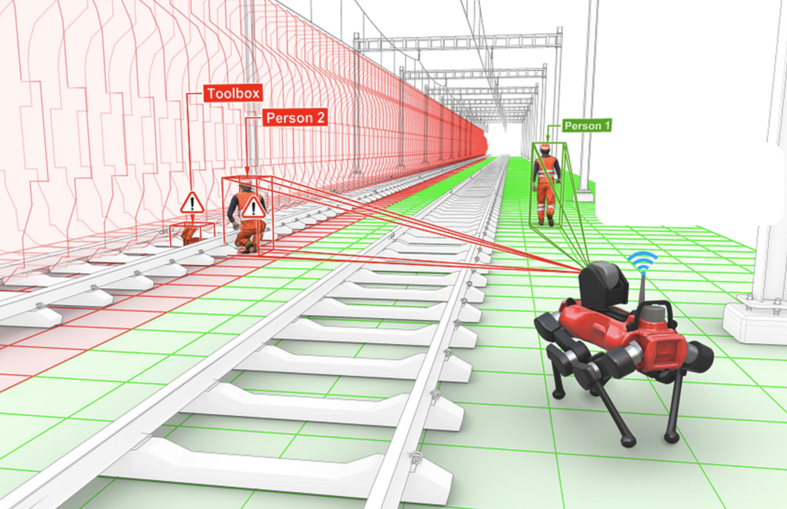

# Railway Danger Zone Monitoring

Master's thesis, ETH Zurich (Robotic Systems Lab), 2025, in collaboration with SBB.

Workers on railway construction sites can step into the danger zone next to tracks that are still in
service. This thesis puts a quadrupedal robot, ANYmal, on site as an assistive safety monitor. It detects
the workers with a camera and LiDAR, estimates where they are, keeps repositioning itself inside the safe
zone to keep them in view, and drives there on its own. The system was tested on data recorded at SBB's
Löwenberg test site and deployed on the real robot.



*Concept: ANYmal monitors the workers from the safe zone (green). The danger zone next to the track is red.*

## Where the code is

| File | Description |
| --- | --- |
| [`sensor_fusion_node.py`](sbb_railway_safety/scripts/sensor_fusion_node.py) | Main ROS node. For each synchronized camera + LiDAR pair: detect workers, compute the best robot pose, plan a path, send a velocity command, publish debug images |
| [`helper_functions_detection.py`](sbb_railway_safety/scripts/helper_functions_detection.py) | Image undistortion and color correction, YOLOv8s person detection, LiDAR-to-camera projection, distance to each person |
| [`helper_functions_UTM.py`](sbb_railway_safety/scripts/helper_functions_UTM.py) | Worker positions in the robot frame; safe-zone polygon from GPS (UTM) to the robot frame |
| [`helper_functions_positioning.py`](sbb_railway_safety/scripts/helper_functions_positioning.py) | Cost map over sampled robot poses and the resulting best position and heading |
| [`helper_functions_navigation.py`](sbb_railway_safety/scripts/helper_functions_navigation.py) | Dijkstra path planning over the cost map, waypoints, trajectory following |
| [`helper_functions_visualization.py`](sbb_railway_safety/scripts/helper_functions_visualization.py) | Debug plots, published as ROS images |
| [`velocity_publisher_node.py`](sbb_railway_safety/scripts/velocity_publisher_node.py) | Republishes the latest velocity command at a fixed rate and stops the robot if none arrives for 1.5 s |
| [`sensor_fusion.launch`](sbb_railway_safety/launch/sensor_fusion.launch) | Launch file with the camera and LiDAR topics |
| [`prototypes/`](prototypes) | Early 2D simulations of the positioning cost function with random workers and obstacles |

`sbb_railway_safety/` is a ROS (catkin) package named `sensor_fusion_package`.

## How it works

**Detection:** camera images are undistorted and color-corrected, and YOLOv8s detects people. LiDAR points
are transformed into the camera frame and projected onto the image. For each detection, the depths of the
LiDAR points inside its bounding box go into a histogram, and the most frequent bin is taken as the
worker's distance. This is more robust to overlapping people than taking the closest point.

**Positioning:** a 10 m × 10 m grid in front of the robot is sampled (20 × 20 points, 36° heading steps).
Cells outside the safe-zone polygon are dropped, and cells closer than 1 m to a worker get a very high
cost. Every other pose gets a weighted cost:

- workers in view (90° field of view), weighted highest
- angular spread of the visible workers, so nobody sits at the edge of the image
- heading offset from the workers' average direction, to keep them centered
- average distance to the visible workers
- distance from the current position, to avoid needless movement
- distance from the previous best pose, to keep the goal stable between frames

The lowest-cost pose is the goal.

**Navigation:** a modified Dijkstra search over the cost map plans a path to the goal that stays in
low-cost cells along the way. A point-by-point trajectory follower turns it into linear and angular
velocity commands for the ANYmal base controller. Everything is recomputed on every frame, so the robot
keeps adapting as workers move.

**Localization:** a NovAtel CPT7 GNSS receiver with PPP corrections (a few cm accuracy) places the robot
relative to the safe zone, which comes from SBB's geo-referenced site map.

In this version of `sensor_fusion_node.py`, the GPS and safe-zone inputs are commented out and positioning
runs on the detected workers only.

## Running it

Written in 2025 for ROS 1 (Python 3.8) on ANYmal with the Boxi sensor box (Alphasense camera, Hesai XT32
LiDAR, NovAtel CPT7). It has not been re-tested since.

```bash
# inside a catkin workspace
cp -r sbb_railway_safety ~/catkin_ws/src/
pip install ultralytics pyproj opencv-python numpy matplotlib
cd ~/catkin_ws && catkin build sensor_fusion_package && source devel/setup.bash
roslaunch sensor_fusion_package sensor_fusion.launch
rosrun sensor_fusion_package velocity_publisher_node.py
```

It also needs `cv_bridge` and `novatel_oem7_msgs`. The YOLOv8s weights download automatically on first run.

## Credits

- Supervision: Andrei Cramariuc, Olga Vysotska and Prof. Marco Hutter (Robotic Systems Lab, ETH Zurich).
- Site access, data and collaboration: SBB.
